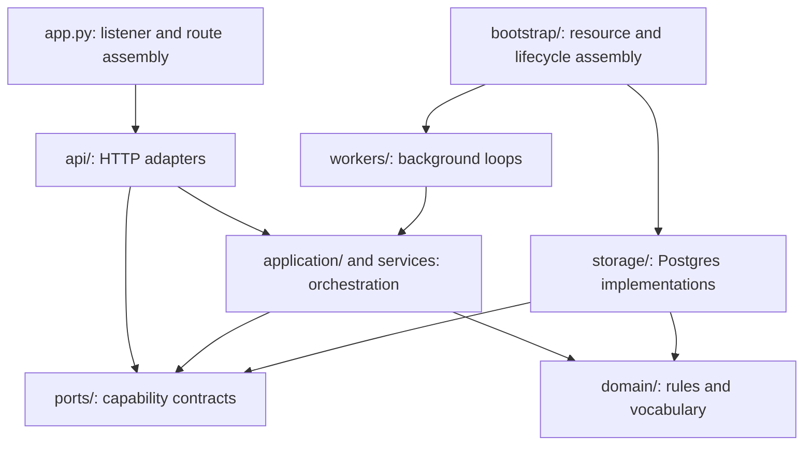

# Code structure

Where behavior belongs, and how to follow it through the repository. The
[developer guide](development.md) covers setup, checks and the import rules;
[AGENTS.md](../../AGENTS.md) covers the service and security boundaries.

## Start with the deployment boundary

```text
apps/
  backend/
    cloud_agent/          Control plane and its HTTP APIs
    cloud_agent_host/     Host execution and retained sandbox management
    cloud_agent_shared/   Contracts and algorithms shipped in both images
    migrations/           Agent-owned database schema, managed by Alembic
    openapi.json          The committed snapshot of this service's OpenAPI
  frontend/              Next.js browser UI and backend-for-frontend routes
deploy/                  Image builds and deployment entry points
scripts/                 Development, qualification, and release tooling
tests/                   Backend behavior, integration, and boundary checks
docs/                    Maintained guides and design records
```

The control plane and the host are deployed separately and never import each
other. Shared code holds the facts and contracts they agree on, and imports
neither.

## Vocabulary

The code and the wire keep their historical names; documentation and new code
use the terms in the first column. A job is one turn of a conversation, not the
user's whole task.

| Term | In code and on the wire | Meaning |
|---|---|---|
| Conversation | thread, `thread_id` | One user session, made of turns; a chat or task in the UI |
| Turn | job, `job_id`, `turn_no` | One user message and the agent's work on it; every turn after the first names its `parent_job_id` |
| Attempt | `attempt_id`, `attempt_no`, `lease_generation` | One execution of a turn on one host; it carries the lease fence |
| Sandbox group | `agent_sandboxes`, `sandbox_id`, `sandbox_generation` | One retained container and its workspace |
| Member | membership, member | One conversation in a group, with its own native session and CLI process |
| Activation, residency, process | `activation_generation`, `residency_generation`, `process_generation` | A member's three layers: its activation in the container, the residency that lets one live CLI process serve later turns, and that process. A stale generation is refused at its layer |
| Placeholder credential | `amr.` (MCP), `agh.` (GitHub), `amd.` (Model relay) | A bearer that names one residency. Only its relay accepts it, and the relay resolves the fence again on every request |

Never name a new field a bare `generation`: say what it counts, as in
`sandbox_generation` or `residency_generation`.

## Follow a control-plane request



`app.py` mounts the four listeners (the owner and admin API, the MCP-only
listener, the GitHub relay and the model relay) and installs the shared
response and exception policies. On the API and MCP listeners,
`api/_parameters.py` refuses with a 422, before any route runs, what Postgres
cannot store: NUL or an integer beyond `bigint` in a path or query parameter,
and NUL or a lone surrogate in a JSON body an owner or administrator sends.
Host and sandbox reports replace those characters instead.
`bootstrap/lifespan.py` builds the resources and starts and stops background
work; route modules own no startup or shutdown.

| Directory or module | Owns | Put a change here when |
|---|---|---|
| `api/` | HTTP parsing, dependencies, authorization entry points, response mapping | The request or response behavior changes |
| `schemas/` | Pydantic request, response, and host/worker wire models | A transport field or validation rule changes |
| `application/` | Admission, follow-ups, Fork, delivery, reconciliation, and other flows | A use case coordinates several capabilities |
| `domain/` | Execution state, request identity, and business vocabulary | A rule is independent of persistence and HTTP |
| `ports/` | Narrow typed capabilities | A caller needs a new operation from an adapter |
| `storage/assembly.py` | Construction of Postgres repository capabilities | A storage capability is wired into the service |
| `storage/repositories/` | SQL and transaction/fencing behavior | A durable query or mutation changes |
| `workers/` | Scheduled work and recovery loops | Work continues independently of a request; queue and goal recovery cannot hold up attempt lease recovery |
| `bootstrap/` | Resources and lifecycle | A component must be constructed, started, or closed |
| `mcp/` | MCP hosting, transport, policy, and process-local runtime | Protocol or upstream session behavior changes |
| `goals/` | Goal orchestration and retry policy | Goal scheduling or progress policy changes |
| `providers/` | External provider implementations | A provider's integration behavior changes |

Storage and errors follow four rules:

- Outside `storage/`, callers import only the storage assembly and type against
  the capabilities they use, such as `store.host_pool` or
  `store.pending_messages`. They never import a Postgres repository or reach
  through the assembly to its pool.
- A port imports only `domain/`, `schemas/`, `cloud_agent_shared`, other ports
  and libraries, because its caller and its implementation both depend on what
  it names. Move a type a new port needs to `domain/` or `schemas/` first.
- Do not add a port that only repeats its repository's methods. Let the
  assembly name the repository class, and have each caller declare the narrow
  Protocol it uses, as `api/config.py` does for model preferences.
- Application flows raise the domain errors `Refused` and `Unavailable`
  (`domain/errors.py`), never HTTP errors; `api/errors.py` maps them to a
  status, headers and body. A test refuses FastAPI and Starlette imports in
  `application/` and `domain/`.

`mcp/runtime.py` owns MCP sessions: lazy host construction, fenced reaping,
maintenance and closing. The relay's handlers and bootstrap both call it
directly. `application/send_now.py` owns the eager send-now handoff tasks;
crash recovery stays with the durable delivery rows and their recovery worker.

## API schemas are organized by domain

Import public models from `cloud_agent.schemas`, whose `__init__.py` exports
them explicitly. Modules inside the package import each other directly, not
through that facade.

| Modules | Models for |
|---|---|
| `jobs`, `conversations`, `messages`, `goals` | Tasks, sessions, queues, questions, and goals |
| `events`, `resources`, `workspace` | Event streams, measurements, files, terminals, and Git views |
| `workers`, `hosts`, `admin_hosts` | Worker requests, enrollment, heartbeats, and admin host controls |
| `archive_settings`, `audit`, `config` | Archive settings, admin audit, and advertised configuration |
| `runtime_upgrades` | Agent CLI updates started from the admin Settings page |
| `integrations`, `mcp`, `session` | Source control, MCP selection, identity, and user preferences |
| `teams` | Teams, members, invitations, and join requests |
| `_host_reports`, `_prompts` | Private helpers: bounds for host and worker reports, and the prompt text rule |

Keep model names and serialized behavior stable in a structural refactor, and
make cross-domain annotations resolve right after import. An intentional wire
change needs [a contract update](development.md#changing-an-api).

## Follow a host execution

The host package groups its modules by concern. Paths below are relative to
`cloud_agent_host/`.

| Package | Owns |
|---|---|
| `service/` | The long-lived host service: enrollment, heartbeats, the claim loop, draining, what the host advertises, and starting each turn's child |
| `turn/` | One claimed turn in its child process: reservation, source preparation, the attempt's stages, and the stream it relays |
| `container/` | The Docker/Kata boundary: retained chat containers, their models and markers, and the exact-container identity gate |
| `network/` | The sandbox network: this deployment's host rules, per-group bridges, and the workloads that depend on them |
| `supervisor/` | The shared-session supervisor: one group's lifecycle, registration and reconciliation, its members and their native sessions |
| `archive/` | Sandbox archives, restorable checkpoints, and verified deletion of stopped sandboxes |
| `observe/` | The guest observer, member execution windows, tool windows, and Docker resource samples |
| `member_setup/` | What the trusted host installs into a member before its CLI starts: plugins, MCP helpers, runtimes, trusted files |
| `launch/`, `runtimes/`, `manager_api/` | Launch facets, the Agent CLI adapters, and the Sandbox Manager's HTTP layer |

The top level keeps the process entry points (`runner.py`,
`sandbox_manager.py`, `candidate_check.py`, and the `host_capacity` and
`storage_attestation` commands that deployment runs inside a runner) and the
modules several packages share, such as `claimed_job.py`,
`control_plane_client.py`, `drivers.py`, `resident_transport.py` and
`session_lifecycle.py`.

`runner.py` is the command line. The host service (`service/host_service.py`)
enrolls the host, heartbeats, claims turns up to its limit and drains on
SIGTERM; `service/host_capabilities.py` holds what it advertises and the proof
each claim carries. Each claimed turn runs in a child process,
`turn/turn_child.py`, under the lease that `service/attempt_lease.py` renews:

- `turn/group_reservation.py` checks and reserves the turn's sandbox group;
- `turn/shared_live_attempt.py` runs the attempt as a sequence of stages;
- `turn/turn_stream.py` relays the admitted turn;
- `turn/source_preparation.py` does the trusted Git work on the chat's source,
  outside the sandbox.

`claimed_job.py` defines claim payloads and lease errors.
`control_plane_client.py` owns attempt-scoped worker HTTP calls, deadlines and
event replay; it queues a turn's events on the ordered sender in
`event_sender.py`, which uploads them in batches.

### Containers and the group lifecycle

- `container/chat_sandbox_models.py` holds retained-container specs,
  inspection and status values, ownership labels and identity bounds.
- `container/chat_sandbox.py` manages retained groups and their members. Its
  `ChatSandboxManager` is assembled from one mixin per concern: container
  creation (`chat_sandbox_create.py`), member execs and processes
  (`chat_sandbox_members.py`), workspace and home files
  (`chat_sandbox_workspace.py`), the guest observer
  (`chat_sandbox_observation.py`) and archive markers
  (`chat_sandbox_markers.py`). Terminals and the retained backend are in
  `chat_sandbox_terminal.py` and `retained_backend.py`. A test pins the
  manager's method set.
- `network/chat_sandbox_network.py` owns group bridges, relay membership, Kata
  guest routes, and network proof and release, through a narrow container
  protocol. Exact container identity, bounded exec and fail-stop operations
  stay with the manager. The in-guest network check is
  `network/guest_network_check.py`.
- `container/sandbox.py` owns the container and process boundary.
  `observe/sandbox_inventory.py` is the retained-container inventory the
  capacity report reads.

Stop, orphan recovery and archive deletion reserve the group's lifecycle
before any Docker or marker I/O, then check the group, member, container and
lifecycle identities again before accepting the result. The supervisor's
metadata lock protects in-memory ownership only.

A group's lifecycle is one value, `GroupLifecycleState`
(`supervisor/group_lifecycle_state.py`): which start, stop, exclusive workspace
operation and lifecycle check hold it, the barriers still owed (a final
archive, an orphan finalization), and the run's fence label. Only that module's
transitions change it, and a test refuses any other assignment.
`supervisor/group_lifecycle.py` is the admission table that decides what may
run now. The [design](../agents/specs/2026-11-05-group-lifecycle-state.zh-CN.md)
lists the reachable combinations and the invariants the tests check.

### Agent CLI adapters

The adapters live in `cloud_agent_host/runtimes/`, one package per CLI:

| Module | Responsibility |
|---|---|
| `base.py` | Adapter contracts, capabilities, MCP configuration, and runtime errors |
| `events.py` | Normalized event vocabulary and bounded payload helpers |
| `preview.py` | Partial-reply preview batching |
| `member_launch.py` | The steps one CLI adds to a member's launch, with a CLI-free default |
| `claude/` | Claude Code: its launch and event parsing (`adapter`), live session (`session`), background tasks (`background`), plugins (`plugins`), and member config, launch steps and native Fork (`member`) |
| `codex/` | Codex: its app-server launch (`adapter`), notification readings (`app_server`), live session (`session`), MCP relay policy (`mcp`), plugins (`plugins`), and member home, launch steps and Fork recovery (`member`) |
| `pi/` | pi: its launch and event parsing (`adapter`), live session with its native Fork (`session`), and launch steps (`member`) |
| `http_bridge/` | OpenCode and Kilo: the launch they share (`adapter`), each CLI's name, wrapper binary and catalog entry (`opencode`, `kilo`), the bridge's records and live session (`parts`, `session`), Kilo's MCP runtime (`kilo_mcp`), and member home, launch steps and server locks (`member`) |
| `registry.py` | Adapter lookup and construction |
| `live.py` | Each CLI's live session class, the driver that opens it, and its launch steps |

`drivers.py` holds the generic Driver, Session and Turn contract and the base
classes the sessions share. `resident_transport.py` opens member processes and
journals native Forks without branching on the CLI: each CLI's `member` module
defines its launch steps (member config or private home, trusted helpers,
plugin installer, where platform instructions go, and Claude's commit
attribution), and the factory calls them. Only native Fork still branches on
the CLI. `member_setup/member_homes.py` holds the private provider homes of
Codex, OpenCode and Kilo members.

Callers import `cloud_agent_host.runtimes`, which exports the public dialect
API; sessions, `live` and the `member` modules build on `drivers.py`, so import
them by module name. Discovery facts (runtime IDs, MCP support, reasoning
efforts) live in `cloud_agent_shared/runtime_catalog.py`, so the control plane
advertises them without loading host adapters. Version pins are in
`cloud_agent_shared/shared_protocol.py` and the image files.

## Shared operation profiling

Producers import `cloud_agent_shared.operation_profiling`, a facade over
`cloud_agent_shared/profiling/` ([its guide](../../apps/backend/cloud_agent_shared/profiling/README.md)).
Put new profiling logic in the matching concern module, not in the facade.
Clock access goes through its replaceable `time` object, which keeps tests
deterministic and the default-off path intact.

## Follow a browser action

Next.js routes live under `apps/frontend/src/app/`. Shared feature UI is under
`components/features/` (`agents` for tasks and conversations, `settings`,
`teams`, `profile` and `auth`), reusable presentation components under
`components/`, and browser utilities and API clients under `lib/`. Server-only
integrations belong in the existing server modules; a browser component must
not pull server credentials into its import graph.

`lib/api/agents.ts` is the public API facade over the modules in
`lib/api/agents/`: jobs, threads, sessions, goals, configuration,
integrations, resource and usage reads, workspace files, terminals and event
streams. Keep endpoint paths, retries, credentials, cursors and notifications
with the operation that owns them.

Inside `components/features/agents/`, each concern has its own folder:

| Folder | Responsibility |
|---|---|
| `adapt/` | The Job and Thread API-shape adapters, and the event, diff, resource and job-state readers they share |
| `conversation/` | Transcript, turns, tool activity, turn navigation and the side chat |
| `composer/` | Message input, the new-task composer, model and repository pickers, queued messages |
| `sidebar/` | Conversation list, folders, search, archive and getting started |
| `workspace/` | Workspace files and tabs, terminals, recorded diffs, temporary workspaces |
| `trajectory/` | Trajectory view, step inspector, and the protocol and step projections |

Feature areas such as `context/`, `environment/`, `goal/`, `mcp/` and `skills/`
follow the same rule. The top level keeps what several folders share:
`types.ts`, the job and conversation records, the read and push providers, and
the job page. Tests sit next to the module they test.

`components/features/agents/JobDetail.tsx` composes the job page from the
modules under `job-detail/`:

| Module | Responsibility |
|---|---|
| `JobDetailHeader` | Page header and conversation actions |
| `JobTranscript` | Transcript projection and navigation |
| `JobComposer`, `useJobComposerSettings` | Message input and composer settings |
| `RunOutcome`, `GitPanel` | Outcome, pull request, and Git interaction |
| `JobDetailSidePanels`, `LazyPanels` | Workspace/inspector rendering and lazy loading |
| `useJobDetailPanels` | Panel selection, focus, resizing, and retained panel state |
| `useJobConversation` | Turn navigation, transcript scrolling, and reading position |
| `useJobRunActions` | Stop, Fork, and restore actions with request guards |

Keep state with the concern that owns it. Retained panels keep terminals, file
previews and drafts while hidden, and a scope change must reset the state it
affects. Keep hook dependencies explicit, and keep lazy loading when you
extract a component.

## Add a feature without losing the structure

1. Find the service and concern that own the behavior in the maps above.
2. Add a domain rule, wire model or port only where the behavior needs one, and
   implement durable operations inside storage.
3. Put orchestration in an application flow or owning service, call it from the
   HTTP adapter or worker, and wire new resources through bootstrap.
4. Export from a public facade on purpose; inside a package, import
   implementation modules directly.
5. Test the observable behavior and the boundaries it crosses, run the gates,
   and update the guide that owns any changed ownership, command or behavior.
